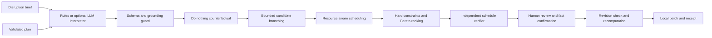

# DeliveryGuard architecture

The central design separates uncertain language interpretation from deterministic business calculations. The agent can propose a grounded change, but only allowlisted tools can evaluate and apply it.

## Tool contracts

| Tool | Input | Output | Allowed side effects |
| --- | --- | --- | --- |
| `validatePlan` | Plan JSON | Validated plan or typed error | None |
| `interpretLocal` | Brief and active plan | Ready, clarify, or blocked | None |
| `interpretOpenAI` | Brief and minimal plan context | Validated structured interpretation | One bounded provider request |
| `applyDisruption` | Plan and allowlisted change | New effective plan | None; input stays unchanged |
| `recover` | Plan, change, profile, confirmations | Candidates, metrics, winner, truncation | None |
| `critique` | Candidate and original plan | Independent constraint check result | None |
| `approveCandidate` | Current plan, result, candidate, approval | New plan and receipt | None until caller stores the returned plan |

## State transitions

`input → validated → interpreted → planned → verified → waiting for approval → applied`

Ambiguous input exits to clarification. Unsupported instructions exit to blocked. No feasible candidate exits to no solution. Provider errors terminate the run without a hidden fallback presented as live AI. A stale revision forces re-evaluation. Unverified external assumptions prevent approval.

The browser performs the deterministic workflow locally. The optional Node server exposes interpretation only; it does not offer arbitrary tools, shell execution, file writes, or communication endpoints.

## Advanced agent concepts implemented

- **Grounded context:** the interpreter receives the active plan’s declared resources and constraints; targets must exist.
- **Structured output:** an optional model returns a strict schema; evidence must be an exact input excerpt and include the proposed numeric value. Explicit local extraction and model interpretation must agree when both apply.
- **Plan, execute, verify:** the coordinator records observable tool actions; a separate verifier inspects the schedule instead of trusting summary text.
- **Counterfactual reasoning:** the unchanged disrupted plan establishes the cost and timing baseline for recovery.
- **Branching and multi-objective selection:** declared alternatives and optional deferrals create candidate branches. Feasibility filtering precedes Pareto analysis and scoring.
- **Bounded autonomy:** at most 512 assignments and eight trace events; the model interpreter makes one request with no recursive tool calls.
- **Human checkpoint:** external facts and scope changes require review; the selected patch is re-evaluated against a fresh current revision.
- **Replay evidence:** inputs, outputs, metrics, and patches can be exported. Receipts identify revisions and local approval time.

These are functional stages in one orchestrated workflow, not a multi-model swarm. The live model is optional and restricted to interpretation. There is no RAG corpus or persistent conversational memory; grounding uses the current plan.

## Scheduling and ranking

Tasks form a directed acyclic graph. Required ready tasks receive priority, followed by stable task-ID ordering. Each task starts after its dependencies and its resource’s most recently scheduled task. Resource availability is a release time. The engine enforces one active task per resource.

This serial schedule-generation heuristic may delay an otherwise usable idle slot and may miss a globally better ordering. Pareto and ranking results are relative to the explored alternatives and the heuristic schedule. They are not a mathematical proof of a global optimum.

Five minimized objectives drive comparison: total delivery cost, task-change count, deferred task-value fraction, normalized schedule movement, and unconfirmed external-fact count. Profiles expose fixed weights in `PROFILES`; scores are a declared preference mechanism, not probabilities or calibrated confidence.

Hard constraints are never traded away by score: cost must fit the budget, all tasks must finish within the deadline, required scope must remain, and contribution margin must meet the floor. Optional prerequisites cannot be removed if a required descendant depends on them.

## Trust boundaries

User input and model output are untrusted. Known unsafe phrases are blocked before provider access; this is not a complete prompt-injection defense. Stronger protection comes from the small tool surface, parameter validation, explicit evidence, deterministic calculations, and absence of external-action tools.

Browser storage is editable and readable by local scripts on the origin. It is not a secure ledger. The revision token is a canonicalized FNV checksum for accidental stale-state detection; it does not provide collision-resistant authentication. Approval is a local interaction, not a legal signature.

The Node server binds to loopback, rejects cross-origin interpretation requests, bounds body size, rate-limits calls, and emits security headers. Do not expose it publicly with an API key without authentication, HTTPS, tenant isolation, and a deployment security review.

The provider request follows [official OpenAI Structured Outputs guidance](https://developers.openai.com/api/docs/guides/structured-outputs). No key is embedded in the static app or submitted archive.
